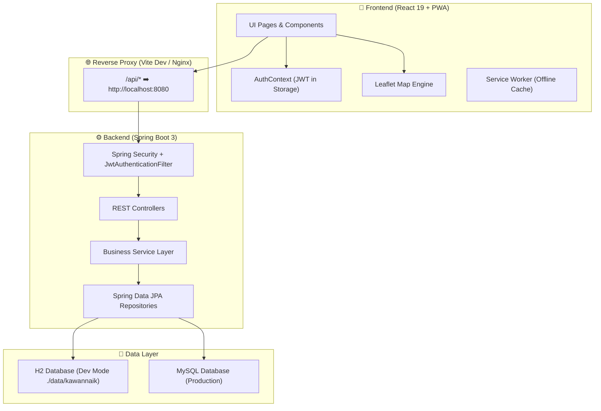

<div align="center">

# 🏔️ KawanNaik

**Platform Hiking Buddy Finder & Panduan Jalur Pendakian Gunung Indonesia**

Temukan kawan mendaki sefrekuensi, jelajahi jalur pendakian terbaik, dan daki gunung dengan aman.

[](https://openjdk.org/)
[](https://spring.io/projects/spring-boot)
[](https://react.dev/)
[](https://vitejs.dev/)
[](https://web.dev/progressive-web-apps/)
[](https://leafletjs.com/)
[](http://localhost:8080/swagger-ui.html)

[Fitur Utama](#-fitur-utama) •
[Tech Stack](#-tech-stack) •
[Arsitektur](#-arsitektur-sistem) •
[Cara Menjalankan](#-panduan-instalasi--menjalankan) •
[Akun Demo](#-akun-demo-bawaan) •
[Dokumentasi API](#-dokumentasi-api-swagger)

---

</div>

## 📖 Tentang KawanNaik

**KawanNaik** hadir untuk menyelesaikan tantangan para pegiat alam bebas di Indonesia:
- 👥 **Sulit mencari teman mendaki:** Banyak pendaki kesulitan mencocokkan jadwal dan mencari partner yang selevel.
- ⚠️ **Kecelakaan akibat salah jalur:** Minimnya informasi titik pos, sumber air, dan titik rawan pendakian.
- ⚖️ **Ketidaksesuaian fisik:** Jalur ekstrem sering didaki pemula tanpa persiapan memadai.

KawanNaik memfasilitasi pembuatan **Rencana Pendakian (Open Trip / Hiking Buddy)** dengan validasi kesesuaian level fisik, pemetaan interaktif titik-titik pos dan sumber air, serta edukasi SOP keselamatan mendaki.

---

## ✨ Fitur Utama

| Fitur | Deskripsi |
| :--- | :--- |
| 👥 **Hiking Buddy Finder** | Buat rencana pendakian, tentukan kuota dan level minimal, kelola pengajuan peserta (`MENUNGGU`, `DITERIMA`, `DITOLAK`). |
| 🏔️ **Katalog Gunung & Jalur** | Database gunung Indonesia lengkap dengan mdpl, koordinat GPS, estimasi waktu tempuh, dan tingkat kesulitan. |
| 📍 **Peta & Titik Pos (Waypoints)** | Peta interaktif Leaflet menampilkan Basecamp, Pos Istirahat, Sumber Air, dan Titik Rawan. |
| 🛡️ **Panduan Keselamatan** | Artikel edukasi SOP penanganan hipotermia, navigasi darat, logistik, dan etika pendakian. |
| 📱 **Progressive Web App (PWA)** | Dapat diinstall di smartphone/desktop, cepat, responsif, dan mendukung caching offline via Workbox. |
| 🔐 **Keamanan & Role-Based** | Otentikasi JWT Stateless dengan pemisahan hak akses: `PENDAKI` dan `ADMIN`. |
| ⚙️ **Panel Admin Lengkap** | Kelola data master gunung, jalur, waypoints pos, dan panduan keselamatan secara visual. |

---

## 🛠️ Tech Stack

### Backend
- **Core:** Java 21 LTS
- **Framework:** Spring Boot 3.4.1 (Spring MVC, Spring Data JPA, Spring Security)
- **Authentication:** JWT (JSON Web Token - `io.jsonwebtoken:jjwt:0.12.6`)
- **Database:**
  - **H2 Database** (Default dev profile: file lokal persisten `./data/kawannaik` tanpa perlu install server database)
  - **MySQL / PostgreSQL** (Ready for production)
- **API Documentation:** Springdoc OpenAPI 2.8.4 (Swagger UI)
- **Testing:** JUnit 5, Mockito, Spring Security Test

### Frontend
- **Framework:** React 19 (Single Page Application)
- **Build Tool:** Vite 8
- **PWA Engine:** `vite-plugin-pwa` + Workbox
- **Peta Interaktif:** Leaflet.js
- **Routing:** React Router v7
- **HTTP Client:** Axios (Interceptors terintegrasi Bearer Token JWT)
- **Styling:** Modern Responsive CSS (Design System tokens, mobile-first app shell)

---

## 🏛️ Arsitektur Sistem



---

## 📂 Struktur Direktori

```plaintext
KawanNaik/
├── backend/
│   ├── src/main/java/com/kawannaik/
│   │   ├── config/          # SecurityConfig, DataSeeder, OpenApiConfig
│   │   ├── controller/      # REST API Controllers (Gunung, Jalur, Rencana, Auth)
│   │   ├── dto/             # Request & Response Data Transfer Objects
│   │   ├── exception/       # GlobalExceptionHandler & custom exceptions
│   │   ├── model/           # JPA Entities (Pengguna, Gunung, Jalur, Titik, Rencana)
│   │   ├── repository/      # Spring Data JPA Repositories
│   │   ├── security/        # JWT Token Provider, CustomUserDetails
│   │   └── service/         # Service interfaces & business logic implementations
│   └── src/main/resources/
│       ├── application.properties         # Config utama (Profile active: dev)
│       ├── application-dev.properties     # Config H2 file lokal persisten
│       └── application-mysql.properties   # Config koneksi MySQL
├── data/                    # Database file H2 lokal (kawannaik.mv.db)
├── docs/                    # Dokumentasi teknis, ERD.md, dan schema.sql
├── frontend/
│   ├── public/              # Favicon, SVG icons, PWA manifest icons
│   ├── src/
│   │   ├── components/      # Reusable UI (BottomNav, Navbar, Toast, Banners)
│   │   ├── context/         # AuthContext & State Management
│   │   ├── lib/             # Axios API instance & endpoints
│   │   └── pages/           # Halaman Aplikasi (Gunung, Rencana, Admin, Profil)
│   ├── package.json
│   └── vite.config.js       # Konfigurasi Vite & PWA Workbox
├── pom.xml                  # Konfigurasi Maven dependencies
└── README.md
```

---

## 🚀 Panduan Instalasi & Menjalankan

### Prasyarat
- **Java:** JDK 21 atau lebih baru (`java -version`)
- **Node.js:** v18 atau lebih baru (`node -v`)
- **Maven:** Wrapper sudah disediakan (`./mvnw`)

---

### Langkah 1: Jalankan Backend (Spring Boot)

Buka terminal di root direktori proyek:

```bash
# Mode Dev (Default) — Otomatis menggunakan database lokal H2 (Tanpa install MySQL!)
./mvnw spring-boot:run
```

> **Catatan:** Jika ingin menghubungkan ke database MySQL lokal:
> 1. Pastikan MySQL aktif di port 3306 dan buat database: `CREATE DATABASE kawannaik;`
> 2. Jalankan perintah:
>    ```bash
>    ./mvnw spring-boot:run -Dspring-boot.run.profiles=mysql
>    ```

Backend siap di: **`http://localhost:8080`**

---

### Langkah 2: Jalankan Frontend (React + Vite)

Buka terminal baru:

```bash
cd frontend

# Install dependensi (hanya saat pertama kali)
npm install

# Jalankan server frontend
npm run dev
```

Frontend siap di: **`http://localhost:5173`**

---

## 👤 Akun Demo Bawaan

Sistem sudah dilengkapi data uji coba melalui `DataSeeder` saat pertama kali dijalankan:

| Role | Email | Password | Hak Akses |
| :--- | :--- | :--- | :--- |
| **Admin** | `admin@kawannaik.com` | `password123` | Akses penuh: Kelola Gunung, Jalur, Pos, dan Panduan |
| **Pendaki Mahir** | `budi@example.com` | `password123` | Buat & gabung rencana pendakian semua level |
| **Pendaki Menengah**| `sari@example.com` | `password123` | Akses rencana pemula & menengah |
| **Pendaki Pemula** | `andi@example.com` | `password123` | Akses rencana level pemula |

---

## 📑 Dokumentasi API & Swagger

Dokumentasi interaktif OpenAPI / Swagger UI tersedia langsung saat backend berjalan:

- **Swagger UI:** [http://localhost:8080/swagger-ui.html](http://localhost:8080/swagger-ui.html)
- **OpenAPI JSON:** [http://localhost:8080/v3/api-docs](http://localhost:8080/v3/api-docs)
- **H2 Web Console** *(Dev Profile)*: [http://localhost:8080/h2-console](http://localhost:8080/h2-console)  
  - *JDBC URL:* `jdbc:h2:file:./data/kawannaik`  
  - *User:* `sa`  
  - *Password:* *(kosongkan)*

### Ringkasan Endpoint Utama

| Method | Endpoint | Akses | Keterangan |
| :--- | :--- | :--- | :--- |
| `POST` | `/api/v1/auth/register` | Publik | Mendaftar akun baru |
| `POST` | `/api/v1/auth/login` | Publik | Login & mendapatkan JWT token |
| `GET` | `/api/v1/gunung` | Publik | Mengambil daftar semua gunung |
| `GET` | `/api/v1/gunung/{id}` | Publik | Detail gunung beserta jalurnya |
| `GET` | `/api/v1/jalur/{id}/titik` | Publik | Daftar titik pos, basecamp, & sumber air |
| `GET` | `/api/v1/rencana` | Publik | Menampilkan daftar rencana pendakian terbuka |
| `POST` | `/api/v1/rencana` | Pendaki | Membuat rencana pendakian baru |
| `POST` | `/api/v1/rencana/{id}/gabung` | Pendaki | Mengajukan diri bergabung ke pendakian |
| `PUT` | `/api/v1/peserta/{id}/status` | Pembuat | Menerima/menolak permohonan peserta |
| `POST` | `/api/v1/admin/gunung` | Admin | Menambah master data gunung |
| `POST` | `/api/v1/admin/jalur` | Admin | Menambah jalur pendakian baru |

---

## 🧪 Pengujian (Testing)

Proyek ini telah dilengkapi dengan Unit Test dan Integration Test:

```bash
# Menjalankan seluruh test backend
./mvnw test

# Linting frontend
cd frontend
npm run lint
```

---

## 📄 Lisensi & Kontribusi

Dibuat dengan ❤️ untuk komunitas pendaki gunung Indonesia.  
Silakan buat *Pull Request* atau laporkan *Issues* untuk pengembangan lebih lanjut!
